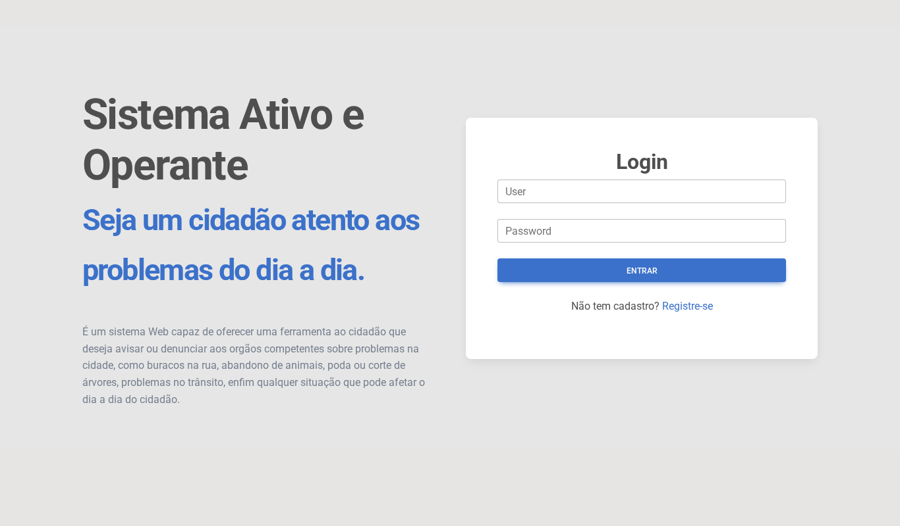
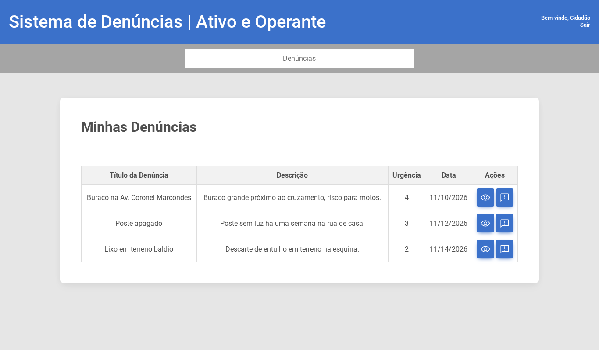
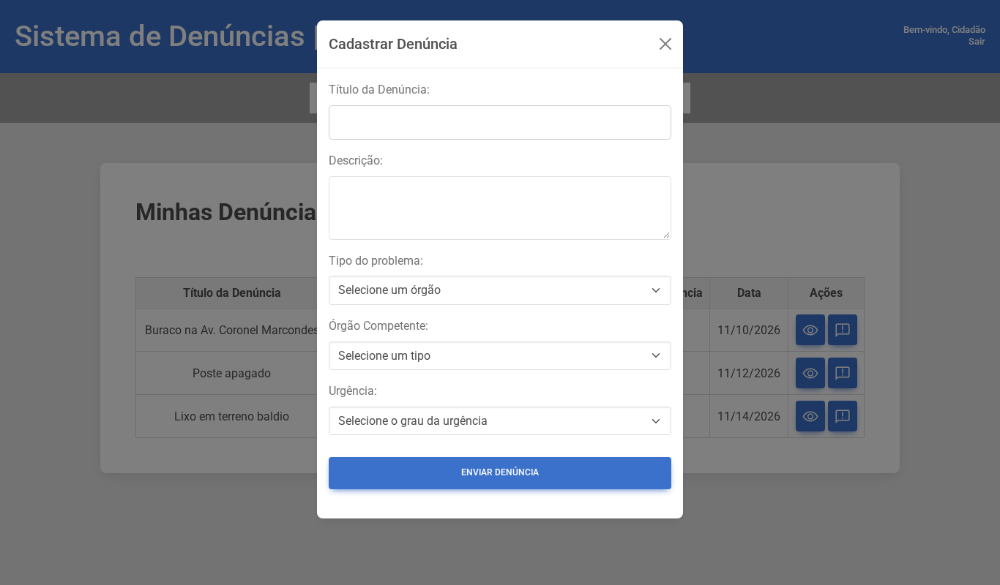
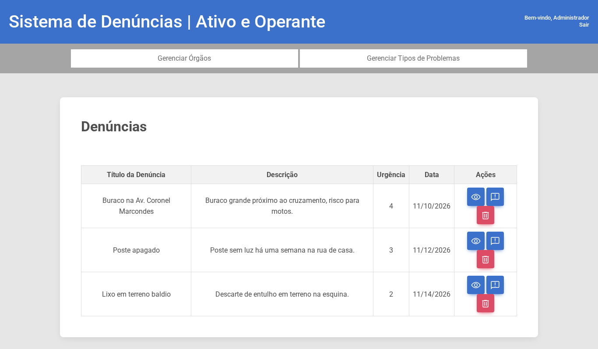

# 🏙️ Ativo e Operante: Sistema de Denúncias

Sistema web para o **cidadão registrar denúncias de problemas urbanos** (buracos, iluminação, lixo etc.) direcionadas aos **órgãos públicos** responsáveis, e para o **administrador acompanhar, responder com feedback e gerenciar** órgãos e tipos de problema. Back-end em **Java + Spring Boot** com API REST protegida por **JWT** e banco **PostgreSQL**; front-end em HTML, CSS e JavaScript servido pelo próprio Spring.

Projeto acadêmico da Unoeste (FIPP).


## 📸 Screenshots

> Capturadas rodando o projeto localmente, com dados de teste inseridos no banco.

| Login | Cidadão: minhas denúncias |
|---|---|
|  |  |

| Cidadão: enviar denúncia | Administrador: denúncias recebidas |
|---|---|
|  |  |

## ✨ Funcionalidades

### 👤 Cidadão
- Cadastro de conta (CPF, e-mail e senha) e login.
- **Envio de denúncia** com título, descrição, urgência, órgão responsável e tipo de problema.
- Lista **"Minhas Denúncias"**, com os detalhes de cada uma e o **feedback** do órgão.

### 🛡️ Administrador
- Lista **todas as denúncias**, com visualização, exclusão e envio de **feedback**.
- Cadastro, listagem, edição e exclusão de **órgãos**.
- Cadastro, listagem, edição e exclusão de **tipos de problema**.

### 🔐 Segurança
- Login gera um **token JWT** (expira em 15 minutos) com o nível do usuário (1 = administrador, 2 = cidadão).
- Um filtro (`AccessFilter`) protege as rotas `/apis/adm/*` e `/apis/cidadao/*`; só o cadastro e a listagem de órgãos e tipos são públicos.

## 🔌 Endpoints da API

**Acesso** (`/apis/security`)

| Método | Rota | Descrição |
|---|---|---|
| POST | `/apis/security/logar/` | Login; retorna o token JWT |
| GET | `/apis/security/verificar-papel/` | Retorna o nível do usuário do token |

**Cidadão** (`/apis/cidadao`)

| Método | Rota | Descrição |
|---|---|---|
| POST | `/apis/cidadao/cadastrar` | Cadastro de cidadão (público) |
| GET | `/apis/cidadao/listar-orgaos` | Lista órgãos (público) |
| GET | `/apis/cidadao/listar-tipos` | Lista tipos de problema (público) |
| POST | `/apis/cidadao/enviar-denuncias` | Envia uma denúncia |
| GET | `/apis/cidadao/minhas-denuncias?userEmail=` | Denúncias do usuário |

**Administrador** (`/apis/adm`)

| Método | Rota | Descrição |
|---|---|---|
| GET | `/apis/adm/get-all-denuncias` | Lista todas as denúncias |
| GET | `/apis/adm/get-denuncia?id=` | Detalhe de uma denúncia |
| PUT | `/apis/adm/editar-denuncia` | Edita denúncia |
| DELETE | `/apis/adm/delete-denuncia?id=` | Exclui denúncia |
| GET | `/apis/adm/get-all-orgaos` · `/apis/adm/get-orgao` | Lista / busca órgão |
| POST | `/apis/adm/add-orgao` | Cadastra órgão |
| PUT | `/apis/adm/alterar-orgao` | Edita órgão |
| DELETE | `/apis/adm/delete-orgao?id=` | Exclui órgão |
| POST | `/apis/adm/add-tipo` | Cadastra tipo de problema |
| GET | `/apis/adm/listar-problemas` | Lista tipos de problema |
| PUT | `/apis/adm/editar-problema` | Edita tipo de problema |
| DELETE | `/apis/adm/excluir-problema?id=` | Exclui tipo de problema |
| POST | `/apis/adm/feedback/denuncia/{denunciaId}` | Envia feedback de uma denúncia |
| GET | `/apis/adm/feedback/denuncia/{denunciaId}` | Consulta o feedback |

## 📁 Estrutura do projeto

```
civic-complaints-spring-boot/
├── pom.xml
└── src/main/
    ├── java/br/unoeste/fipp/ativooperante2024/
    │   ├── config/            # CORS
    │   ├── db/entities/       # Denuncia, Feedback, Orgao, Tipo, Usuario
    │   ├── db/repositories/   # Repositórios Spring Data JPA
    │   ├── restcontrollers/   # Acesso, Cidadão, Admin, Feedback + DTOs
    │   ├── security/          # Filtro de acesso e geração/validação do JWT
    │   └── services/          # Regras de negócio
    └── resources/
        ├── application.properties
        └── static/            # Front-end: index (login), create-user, page-cidadao, page-adm
            ├── assets/        # CSS
            └── controller/    # JavaScript (fetch para a API)
```

## ▶️ Como executar

Pré-requisitos: **JDK 17+** e **PostgreSQL**. O Maven não precisa estar instalado: o projeto traz o Maven Wrapper (`./mvnw`; no Windows, `mvnw.cmd`).

1. Crie o banco:
   ```sql
   CREATE DATABASE ativooperante;
   ```
2. Confira o usuário e a senha do banco em `src/main/resources/application.properties` (`spring.datasource.*`).
3. Crie as tabelas `usuario`, `orgaos`, `tipo`, `denuncia` e `feedback` conforme as entidades em `db/entities`, ou deixe o Hibernate criá-las adicionando ao `application.properties`:
   ```properties
   spring.jpa.hibernate.ddl-auto=update
   ```
4. Execute a aplicação:
   ```bash
   git clone https://github.com/lukinha21/civic-complaints-spring-boot.git
   cd civic-complaints-spring-boot
   ./mvnw spring-boot:run
   ```
   Para gerar o JAR executável (os testes sobem o contexto do Spring, então o PostgreSQL precisa estar rodando; ou use `-DskipTests`):
   ```bash
   ./mvnw package
   java -jar target/AtivoOperante2024-0.0.1-SNAPSHOT.jar
   ```
5. Acesse **http://localhost:8080/index.html**. O front-end chama a API em `http://localhost:8080`, então mantenha essa porta.

> O pacote `br.unoeste.gaspar` é uma versão anterior do projeto, mantida no repositório. A classe principal usada no build é `br.unoeste.fipp.ativooperante2024.AtivoOperante2024Application` (definida em `start-class` no `pom.xml`).

Para entrar como administrador, cadastre um usuário com `usu_nivel = 1` direto no banco; contas criadas pela tela de cadastro são de cidadão (nível 2).

## 👨‍💻 Autores

**Lucas Alexandre**, estudante de Sistemas de Informação na Unoeste

- GitHub: [@lukinha21](https://github.com/lukinha21)
- LinkedIn: [Lucas Silva](https://www.linkedin.com/in/lucas-silva-025583180)

Projeto desenvolvido com **Beatriz Araujo**.
